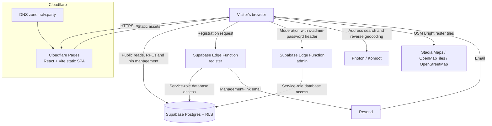

# Ralvessura

A community **trick-or-treat map** for Portugal, inspired by the [Trick or Treat Map](https://www.trickortreatmap.com/map). The interface is written in Portuguese (`pt-PT`). Visitors can browse participating homes on a map or as a list. Each participant receives a private, persistent link for adding, editing, and removing their pins.

Production URL: [ralv.party](https://ralv.party).

## Architecture

- React, TypeScript, and Vite, deployed as a static SPA.
- Leaflet with Stadia Maps' OSM Bright tiles and Photon/Komoot geocoding.
- Supabase Postgres with RLS and RPCs for public reads and pin management.
- A Supabase Edge Function creates registrations and sends management links through Resend.
- A second Edge Function, `admin`, backs the password-protected moderation page at `/admin`.
- Cloudflare Pages serves the static frontend at `ralv.party`.



## Prerequisites

- Node.js `20.19+` or `22.12+` and npm.
- Docker, only when running Supabase locally.
- Free [Supabase](https://supabase.com/dashboard) and [Resend](https://resend.com/) accounts.
- A Cloudflare account with the `ralv.party` zone active, for the production deployment.

## Create the required credentials

### 1. Supabase

1. Create a project in the [Supabase Dashboard](https://supabase.com/dashboard/new), preferably in a European region.
2. Open **Connect** or **Project Settings → API Keys**, then copy:
   - the **Project URL** into `SUPABASE_URL`;
   - the **Publishable key** (`sb_publishable_...`) into `SUPABASE_ANON_KEY`. The environment variable retains its legacy `ANON_KEY` name but accepts the current publishable key.
3. Save the `project-ref` shown in `https://supabase.com/dashboard/project/<project-ref>`.

The URL and publishable key are bundled into the browser application, where access is restricted by RLS. The Vite configuration exposes only these two exact names; never add a secret or service-role key to its `define` block. See the [Supabase API key documentation](https://supabase.com/docs/guides/getting-started/api-keys).

`npx supabase login` opens a browser-based login. For non-interactive CI, create a token under **Supabase Account → Access Tokens** and expose it as `SUPABASE_ACCESS_TOKEN`. A CLI access token is not required for normal local development.

### 2. Resend

1. For production email, add and verify a domain in [Resend Domains](https://resend.com/domains). Resend will display the DNS records that must be created.
2. Open [Resend API Keys](https://resend.com/api-keys) and create a sending key. Restrict it to the verified domain when possible.
3. Copy the key when it is created and store it as `RESEND_API_KEY`; its full value is not shown again.
4. Set `FROM_EMAIL` to an address on the verified domain, such as `map@ralv.party`.

For testing, `onboarding@resend.dev` can send only to the email address associated with your Resend account. Sending to other users requires a verified domain. See the Resend documentation for [API keys](https://resend.com/docs/dashboard/api-keys/introduction) and [verified domains](https://resend.com/docs/dashboard/domains/introduction).

## Run with hosted Supabase

Install dependencies and create the frontend environment file:

```bash
npm ci
cp .env.example .env
```

Populate `.env` with the Supabase values:

```dotenv
SUPABASE_URL=https://<project-ref>.supabase.co
SUPABASE_ANON_KEY=sb_publishable_...
```

Link the CLI to the hosted project and apply the existing migration:

```bash
npx supabase login
npx supabase link --project-ref <project-ref>
npx supabase db push
```

In the Supabase Dashboard, open **Edge Functions → Secrets** and add:

| Name | Value |
| --- | --- |
| `RESEND_API_KEY` | API key created in Resend |
| `FROM_EMAIL` | Sender authorized by Resend |
| `SITE_URL` | `http://localhost:5173` during local development, or `https://ralv.party` in production |
| `ADMIN_PASSWORD` | Password for `/admin`, at least 32 random characters; see [Admin moderation](#admin-moderation) |

The Edge Function runtime receives its own `SUPABASE_URL` and `SUPABASE_SERVICE_ROLE_KEY` automatically from Supabase. The root frontend `.env` also contains the public URL, but it must never contain `SUPABASE_SERVICE_ROLE_KEY`.

Deploy the registration and admin functions:

```bash
npx supabase functions deploy register
npx supabase functions deploy admin
```

Start the frontend:

```bash
npm run dev
```

Open [http://localhost:5173](http://localhost:5173).

## Run Supabase locally

With Docker running, start the local stack and inspect its credentials:

```bash
npx supabase start
npx supabase status
```

Copy the displayed API URL and publishable/anon key into `.env`. Create `supabase/functions/.env`, which is ignored by Git:

```dotenv
RESEND_API_KEY=re_...
FROM_EMAIL=onboarding@resend.dev
SITE_URL=http://localhost:5173
ADMIN_PASSWORD=<output of openssl rand -hex 32>
```

Run the functions and frontend in separate terminals:

```bash
npx supabase functions serve --env-file supabase/functions/.env
```

```bash
npm run dev
```

## Checks and production build

```bash
npm run check    # Run TypeScript checks
npm run build    # Build the production bundle in dist/
npm run preview  # Preview the production bundle locally
```

Manually test the complete flow: register an email, open `/gerir/{uuid}`, create, edit, and remove a pin, then confirm the result on the public map. For moderation, open `/admin`, sign in with `ADMIN_PASSWORD`, then edit and remove a pin and a participant.

## Deploy to Cloudflare Pages

The production deployment uses Cloudflare Pages Direct Upload. It builds locally using the public Supabase values from `.env`, then uploads `dist/` through Wrangler. The deploy command is:

```bash
npm run deploy
```

This runs `npm run build && npx wrangler pages deploy dist --project-name=ralvessura`. `SUPABASE_URL` and `SUPABASE_ANON_KEY` are intentionally public browser configuration and are compiled into the static bundle; do not put a service-role key in `.env`, Pages, or Wrangler.

### One-time setup

1. Complete the hosted Supabase and Resend setup above. Before building, ensure the root `.env` contains the production `SUPABASE_URL` and `SUPABASE_ANON_KEY` values.
2. Authenticate Wrangler in the Cloudflare account that owns `ralv.party`:

   ```bash
   npx wrangler login
   ```

3. Create the Pages project once, with `main` as its production branch:

   ```bash
   npx wrangler pages project create ralvessura --production-branch master
   ```

4. Publish the first deployment:

   ```bash
   npm run deploy
   ```

5. In Cloudflare, open **Workers & Pages → ralvessura → Custom domains → Set up a domain**, enter `ralv.party`, and activate it. Because `ralv.party` is an apex domain, its zone must remain on Cloudflare nameservers. Complete this dashboard flow rather than creating a DNS record manually; Cloudflare creates the required record when the zone is in the same account.
6. In Supabase, set the `SITE_URL` Edge Function secret to `https://ralv.party`, then redeploy both functions:

   ```bash
   npx supabase functions deploy register
   npx supabase functions deploy admin
   ```

7. Register a test address and open the received `/gerir/{uuid}` link in a private browser window.

The `deploy` script publishes a production deployment. To publish a preview manually, run `npm run build` followed by `npx wrangler pages deploy dist --project-name=ralvessura --branch=<branch-name>`.

Cloudflare Pages projects created with Direct Upload cannot later be converted to Git-integrated projects. Choose the Direct Upload flow above when using `npm run deploy`; use a separate Pages project if automatic deployments from Git are required.

## Admin moderation

The `/admin` page lists every participant and pin, and can edit or delete any pin or participant. It is protected by one fixed password, stored only as the `ADMIN_PASSWORD` Edge Function secret. The browser sends it to the `admin` Edge Function in the `x-admin-password` header on every request. There are no admin accounts; anyone with the password has full moderation access.

### Set the password and deploy

1. Generate a random password and keep it in your shell for the next step only:

   ```bash
   ADMIN_PASSWORD=$(openssl rand -hex 32)
   echo "$ADMIN_PASSWORD"
   ```

   Save the printed 64-character value in a password manager. You will paste it into `/admin` to sign in. The function refuses all requests if the secret is shorter than 32 characters.

2. Store it as a secret in the linked Supabase project. Referencing the variable keeps the value itself out of your shell history:

   ```bash
   npx supabase secrets set ADMIN_PASSWORD="$ADMIN_PASSWORD"
   unset ADMIN_PASSWORD
   ```

   Alternatively, add it in the Supabase Dashboard under **Edge Functions → Secrets**. Confirm it is present with `npx supabase secrets list`, which lists secret names without revealing their values.

3. Check that `SITE_URL` is set to the site's exact origin, `https://ralv.party` in production. The function only allows browser requests from that origin, so a mismatch makes `/admin` fail with a network error.

4. Deploy the function. `supabase/config.toml` already sets `verify_jwt = false` for it, because the function checks the password itself:

   ```bash
   npx supabase functions deploy admin
   ```

   Redeploy it whenever `supabase/functions/admin/` changes.

5. Publish the frontend so the `/admin` route exists in production:

   ```bash
   npm run deploy
   ```

6. Verify the gate. Run this curl command, then sign in with the real password at `https://ralv.party/admin`:

   ```bash
   curl -i -X POST https://<project-ref>.supabase.co/functions/v1/admin \
     -H 'x-admin-password: wrong' -d '{"action":"list"}'
   ```

   A wrong password must return `401` with `{"error":"unauthorized"}`. A `503` with `{"error":"admin_disabled"}` means the secret is missing or too short.

### Rotate the password

If the password may have leaked, repeat steps 1 and 2 with a new value. The secret takes effect without redeploying. Any `/admin` tab still using the old password gets "Palavra-passe inválida." on its next request and must sign in again with the new one.

### Local development

Add the password to the Git-ignored `supabase/functions/.env`, then restart `npx supabase functions serve --env-file supabase/functions/.env`. The env file is only read at startup.

```dotenv
ADMIN_PASSWORD=<output of openssl rand -hex 32>
```

Use a different value from production.

### Troubleshooting

| Symptom on `/admin` | Cause |
| --- | --- |
| "A administração não está configurada." | `ADMIN_PASSWORD` is unset or shorter than 32 characters. |
| "Palavra-passe inválida." | The password does not match the secret. |
| "Não foi possível ligar ao servidor." | The browser blocked the request because `SITE_URL` does not match the page's origin, or the network is down. |
| "Algo correu mal. Tenta de novo mais tarde." | The `admin` function is not deployed (check `npx supabase functions list`) or failed; check its logs in the Supabase Dashboard. |

## Security model

The UUID in `/gerir/{uuid}` is the participant's persistent credential: anyone with the link can control that participant's pins. Never expose `users.id` or `pins.user_id` in public responses, logs, or analytics. Never commit `.env`, `supabase/functions/.env`, or secret keys.

The `admin` Edge Function uses the service role and accepts any request carrying the correct `x-admin-password` header, so the password grants full moderation: reading every participant's name and email, and editing or deleting any pin or participant. It never returns `users.id` or `pins.user_id`. The function refuses all requests when `ADMIN_PASSWORD` is unset or shorter than 32 characters, and compares the password in constant time. A long random value makes rate limiting unnecessary. The `/admin` page keeps the password in `sessionStorage`, so closing the tab forgets it. If the password leaks, rotate it as described in [Rotate the password](#rotate-the-password).

The `register` Edge Function is intentionally public and currently has no CAPTCHA or application-level rate limit. Monitor Supabase and Resend usage, and add abuse protection before promoting the service to a large public audience.
